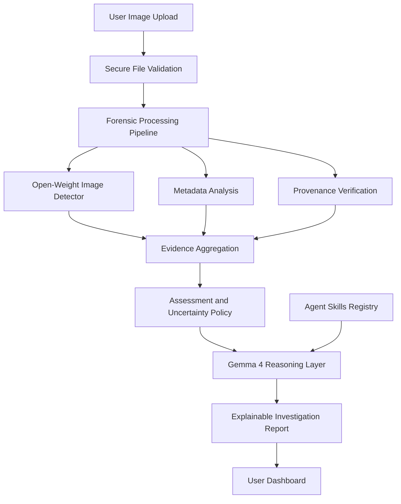

# VeriSight Shield

**AI-Powered Image Authenticity Analysis & Digital Forensics**

*Evidence-driven synthetic media detection. Explainable AI. Privacy-conscious digital safety.*

[Repository](https://github.com/ArhumUsman9/Versight-Ai) · [Report an Issue](https://github.com/ArhumUsman9/Versight-Ai/issues)

---

## Overview

**VeriSight Shield** is an open-source digital forensics initiative focused on detecting AI-generated imagery, investigating digital image authenticity, and supporting individuals affected by synthetic media misuse.

As generative artificial intelligence advances, distinguishing authentic photographs from synthetic or manipulated visual content has become increasingly challenging. Modern image-generation systems can produce highly realistic photographs, synthetic identities, and convincing visual scenes that may evade casual human inspection.

VeriSight Shield addresses this challenge through a modular forensic-analysis architecture that combines **open-weight AI models, image metadata inspection, digital provenance analysis, and explainable AI reasoning**.

The project places particular emphasis on responsible technology, digital identity protection, and the safety of individuals affected by non-consensual image manipulation, impersonation, and deepfake-related harassment.

> **Our mission:** To make digital image authenticity assessment more accessible, evidence-driven, and transparent while advancing responsible AI adoption and digital safety.

## The Problem

The growing accessibility of generative AI has introduced significant risks to digital trust and personal safety.

AI-generated photographs, manipulated identities, and synthetic media can be used to facilitate misinformation, impersonation, reputational harm, and image-based abuse.

Conventional detection approaches face several limitations:

- **Photorealistic generation:** Modern AI images may lack obvious visual inconsistencies.
- **Incomplete metadata:** Social media platforms and messaging applications frequently remove or alter image metadata.
- **Detection generalization:** A model trained on specific generators may perform poorly on images produced by newer systems.
- **Limited interpretability:** Many classification tools provide predictions without sufficient supporting evidence.
- **Privacy concerns:** Uploading sensitive personal photographs to unknown external services can introduce additional risks.

VeriSight Shield is designed to address these challenges through a structured, multi-signal forensic investigation workflow rather than relying exclusively on a single classification prediction.

## Core Capabilities

The following capabilities define the intended application architecture. Individual features should be considered development targets until verified in the implementation.

### AI-Generated Image Detection

A dedicated open-weight computer vision model analyzes uploaded image content for statistical patterns associated with synthetic image generation.

The detection workflow is designed to investigate:

- AI-generated human portraits and synthetic faces
- Photorealistic and hyperrealistic generated imagery
- Artificially generated scenes and objects
- Images affected by resizing, compression, or metadata removal
- Synthetic content produced by different image-generation architectures

The system must use genuine pretrained-model inference, with documented preprocessing, model identity, and evaluation methodology.

### Digital Image Forensics

The forensic analysis layer examines available image properties and metadata to identify potentially relevant technical evidence.

Analysis targets include EXIF and XMP metadata, file format, dimensions, compression characteristics, software identifiers, editing history indicators, and cryptographic hashes.

Where supported, the architecture also incorporates C2PA Content Credentials verification to assess cryptographically signed provenance information.

**Metadata findings are supporting evidence, not definitive proof of authenticity or manipulation.**

### Explainable AI Analysis

VeriSight Shield is designed to deliver interpretable forensic assessments rather than unsupported binary classifications.

The evidence engine combines model predictions with available forensic observations to generate structured findings.

The intended assessment categories are:

| Assessment | Interpretation |
|---|---|
| Likely AI-Generated | Evaluated detection signals indicate possible synthetic image generation. |
| Possible Manipulation | Available evidence suggests editing or compositing that warrants further investigation. |
| No Strong Synthetic Indicators Detected | The implemented checks did not identify strong evidence of synthetic generation. |
| Inconclusive | Evidence is insufficient, conflicting, or unavailable. |

An inconclusive result is preferable to an unsupported claim of authenticity.

### Gemma 4 Integration

The proposed AI reasoning layer uses **Google Gemma 4 through the Gemini API** to interpret structured forensic evidence and assist with investigation workflows.

Its responsibilities include:

- Evidence interpretation and contextual explanation
- Structured forensic report generation
- Investigation workflow and Agent Skill selection
- Human-readable presentation of technical findings
- Multilingual explanations and digital safety guidance

Gemma operates as a reasoning and explanation component. It must not fabricate image-classification results, metadata, provenance records, or confidence values.

### Modular Agent Skills

VeriSight Shield incorporates a modular investigation design based on the [Agent Skills Open Standard](https://agentskills.io/specification).

The proposed skills registry provides reusable workflows for image-authenticity triage, metadata forensics, provenance verification, and digital safety response.

Each skill is defined through a standardized `SKILL.md` file, enabling transparent instructions, controlled execution, and extensibility.

## System Architecture

The architecture separates image processing, model inference, forensic evidence collection, interpretation, and presentation.



### Technology Architecture

| Layer | Technology / Approach |
|---|---|
| Image Intelligence | Dedicated open-weight computer vision model |
| AI Reasoning | Gemma 4 via Gemini API |
| Forensic Processing | Python-based image analysis |
| Metadata Inspection | EXIF/XMP extraction and file inspection |
| Provenance | C2PA verification where supported |
| Agent Workflows | Agent Skills Open Standard |
| API Design | OpenAPI 3.1 specification |
| Source Control | Git and GitHub |
| Application Security | Input validation, data minimization, and controlled execution |

The exact frontend framework, dependencies, model checkpoints, and runtime configuration are determined by the implemented codebase.

## Privacy, Security, and Responsible AI

VeriSight Shield is designed around privacy-conscious image processing and responsible forensic interpretation.

### Privacy Principles

**Data minimization:** Process only information necessary to perform the requested analysis.

**Controlled processing:** Avoid persistent storage of uploaded images unless explicitly required and authorized.

**Third-party transmission:** Do not forward sensitive original photographs to external AI providers without informed consent.

**Metadata protection:** Prevent sensitive location data and identifying metadata from appearing unnecessarily in exported reports.

**Secure credentials:** Keep API keys and service credentials outside committed source code and client-side bundles.

**Responsible reporting:** Provide evidence-preservation guidance without encouraging the circulation of intimate or abusive images.

These principles represent required controls and must be verified through implementation and security testing before accepting sensitive submissions.

### Digital Safety Initiative

VeriSight Shield is particularly motivated by the risks of non-consensual synthetic imagery and image-based harassment.

The project aims to support affected individuals through accessible forensic information, transparent assessments, and responsible guidance for documenting and reporting suspected misuse.

It does not establish identity, determine consent, verify legal culpability, or replace certified forensic examination.

## Model Reliability and Limitations

AI-generated image detection is probabilistic and remains an active research area.

Detection reliability can vary depending on the image generator, compression method, resolution, post-processing pipeline, and similarity to the model's training distribution.

Important distinctions include:

- Detecting a fully AI-generated image is not equivalent to detecting a localized face swap.
- Missing metadata does not prove synthetic generation.
- A low synthetic-image score does not prove that an image is authentic.
- Content credentials can support provenance verification but do not independently establish the truthfulness of an image.
- Detection scores must not be presented as calibrated probabilities without appropriate validation.

The platform is intended to support forensic investigation and informed decision-making, not provide absolute authenticity guarantees.

## Installation and Configuration

Clone the repository:

```bash
git clone https://github.com/ArhumUsman9/Versight-Ai.git
cd Versight-Ai
```

For Gemini API integration, configure a server-side environment variable:

```env
GEMINI_API_KEY=your_api_key
```

The installation commands, package dependencies, model-loading configuration, and execution instructions will be documented against the verified application implementation.

API keys, private datasets, uploaded images, and sensitive reports must never be committed to version control.

## Testing and Quality Assurance

The project follows an evidence-driven evaluation strategy covering functionality, model reliability, security, and privacy.

Core validation areas include:

**Functional validation**
- Upload handling and file validation
- Forensic metadata extraction
- Model inference and output handling
- Evidence aggregation and report generation
- Agent Skill execution and error handling

**Model evaluation**
- Genuine versus synthetic image classification
- Performance on hyperrealistic synthetic imagery
- Robustness to resizing and compression
- Generalization to unseen generators
- False-positive and false-negative analysis
- Inconclusive-result handling

**Security validation**
- Malformed and oversized file handling
- Sensitive metadata exposure
- API key protection
- External API failure handling
- Unauthorized skill execution prevention
- Data retention and deletion behavior

Measured model performance and test results should be published only after reproducible evaluation.

## Open-Source Development

VeriSight Shield is being developed as an extensible open-source project intended to encourage collaboration across artificial intelligence, cybersecurity, and digital forensics.

Contributions are encouraged in the following areas:

- Synthetic media detection and model evaluation
- Digital image forensics
- Privacy-preserving machine learning
- Explainable AI
- Secure application engineering
- Provenance verification
- Agent Skill development
- Accessibility and technical documentation

Contributions involving test imagery must respect copyright, consent, licensing requirements, and personal privacy.

## Hacktoberfest Hack Day

VeriSight Shield is being developed with the technical goals of the **Hacktoberfest Hack Day Faisalabad** Open-Source AI challenges in mind.

The intended submission demonstrates the practical application of open-weight AI, Gemma 4-based reasoning, transparent forensic workflows, and reusable Agent Skills.

**Target categories:**
- Best Open-Source AI Project
- Best Use of Gemma 4

The final submission must include a publicly accessible repository, an appropriate open-source licence, model documentation, reproducible execution instructions, and a functioning demonstration.

## Project Roadmap

| Milestone | Scope |
|---|---|
| MVP | Image upload, real model inference, metadata inspection, explainable results |
| Forensic Enhancement | Provenance checks, improved evidence fusion, hyperrealistic image evaluation |
| AI Integration | Gemma-based evidence interpretation and reusable Agent Skills |
| Security Hardening | Privacy verification, secure processing, input validation, adversarial testing |
| Production Readiness | Model benchmarking, monitoring, deployment automation, and reliability improvements |

## Project Maintainer

**Arhum Usman**

Computer Science | Cybersecurity | Digital Forensics | AI Systems Development

[GitHub](https://github.com/ArhumUsman9) · [LinkedIn](https://www.linkedin.com/in/arhumusman/)

## License

The project is intended for release under the **MIT License** for its original application code. This takes effect when the appropriate licence file is committed to the repository.

Third-party models, pretrained weights, libraries, and datasets remain subject to their respective licences and usage conditions.

---

**VeriSight Shield**

*Advancing Digital Trust Through Explainable AI and Responsible Forensics.*
